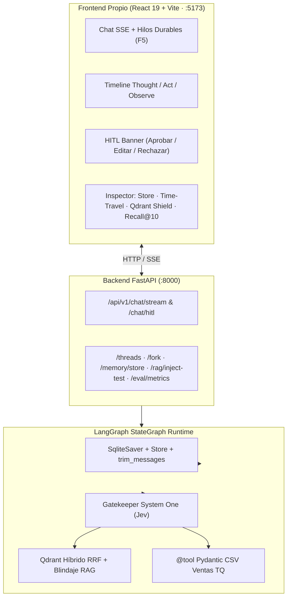

# 🧬 Tecnoquímicas AI — Agente Conversacional Autónomo (Módulo 1 $\to$ Módulo 2)

[](https://github.com/LUISBENJUMEARIVERA/scrapping/actions/workflows/ci.yml)
[](https://www.python.org/downloads/)
[](https://github.com/astral-sh/uv)
[](api/main.py)
[](frontend/)
[](src/agent/graph.py)
[](src/agent/rag_qdrant.py)
[-success)](tests/)
[](LICENSE)

> **Maestría en Inteligencia Artificial y Ciencias de Datos — Universidad Autónoma de Occidente (UAO 2026-2S)**  
> **Grupo 7 — Tecnoquímicas S.A.** | **Autor:** Luis Antonio Benjumea Rivera  
> **Verdad central:** [`CONSTITUTION.md`](CONSTITUTION.md) · **Arquitectura y Comparativas M2:** [`docs/architecture_m2.md`](docs/architecture_m2.md) · **Especificación:** [`specs/modulo2_agent_spec.md`](specs/modulo2_agent_spec.md)

---

## 🎯 De Módulo 1 a Módulo 2: Sistema Agéntico Nivel Agencia de IA

Este proyecto evoluciona el núcleo de extracción web y LCEL del Módulo 1 (`v1.0.0-gold`) hacia un **Agente Conversacional Autónomo Desacoplado**, diseñado para superar el antipatrón del "chat ingenuo":

- **Frontend Propio Desacoplado (`frontend/`):** SPA en **React 19 + TypeScript + Tailwind CSS v4 + Vite** comunicada por **Server-Sent Events (SSE)** con **FastAPI (`api/main.py`)**. *(Streamlit/Gradio eliminados del flujo productivo).*
- **Streaming de Pasos ReAct en Vivo:** Visualización transparente en tiempo real de `Memory Sync` $\to$ `Gatekeeper Jev` $\to$ `Thought` $\to$ `Action (@tool)` $\to$ `Observation`.
- **Memoria Conversacional Dual:**
  - **Corto Plazo:** `SqliteSaver` (`data/memory/checkpoints.sqlite`) indexado por `thread_id` — sobrevive al reinicio del backend y recargas `F5` del navegador, con **Time-Travel** (inspección de checkpoints y bifurcación `fork`).
  - **Control de Ventana:** `trim_messages` (`trim_conversation_context`) + configuración `SummarizationMiddleware`.
  - **Largo Plazo:** `PersistentMemoryStore` (`BaseStore`) con `namespace = ("users", user_id, "profile")` y método `search()` para recordar identidad y preferencias entre hilos completamente nuevos.
- **RAG Documental Híbrido en Qdrant (`src/agent/rag_qdrant.py`):** Índice ANN `HNSW (m=16, ef_construct=100)` con fusión **RRF** (vectores densos + léxicos dispersos BM25) y **citas verificables** exactas (`título`, `sección`, `fragmento`, `URL`).
- **Blindaje del RAG (`src/agent/rag_shield.py`):** Delimitación estricta como datos pasivos (`<contexto_documental_pasivo>`) + detección e inmunidad contra **Prompt Injection Indirecto**.
- **Herramienta Determinista CSV/JSON (`src/agent/tools_structured.py`):** `@tool` validada con **Pydantic v2** sobre `data/gold/tq_ventas_trimestrales.csv` (aritmética exacta en Python, cero cifras inventadas, errores pedagógicos de autocorrección).
- **Gatekeeper System One (Jev) (`src/agent/router.py`):** Clasifica `Choice`, `Noul`, `Score` y `Box` para evitar búsquedas en saludos (`DIRECT_GREETING`), gestionar memoria (`MEMORY_ONLY`), combinar fuentes (`MIXED_HYBRID`) o exigir aprobación humana (`HITL_ACTION`).
- **HITL en Vivo (`interrupt` + `Command(resume=...)`):** Pausa determinista en el grafo con banner interactivo **[Aprobar ejecución] [Editar parámetros] [Rechazar]** en la UI.

---

## 🗺️ Arquitectura del Sistema



Más diagramas detallados (Checkpointer vs. Store, flujo SSE + HITL y comparativa de orquestadores) en [`docs/architecture_m2.md`](docs/architecture_m2.md) y el mapa interactivo del M1 en [`docs/arquitectura.html`](docs/arquitectura.html).

---

## 📊 Evaluación Cuantitativa del Retrieval (`25 consultas etiquetadas`)

| Estrategia en Qdrant (`tq_knowledge_m2`) | Recall@5 | Recall@10 | MRR | nDCG@10 |
| :--- | :---: | :---: | :---: | :---: |
| Dense Only (`Cosine`) | 0.96 | 0.96 | 0.8133 | 0.7929 |
| Lexical Only (`Sparse BM25`) | 0.92 | 0.96 | 0.8744 | 0.8481 |
| **Hybrid RRF (Densa + Léxica)** | **0.96** | **1.00** | **0.8800** | **0.8475** |

- **Precisión del Gatekeeper Router (Jev):** **100%** (11/11 escenarios).
- **Trazabilidad LangSmith:** Configurada en [`.env.example`](.env.example) (`LANGSMITH_TRACING=true`, `LANGSMITH_PROJECT=tecnoquimicas-modulo2-agent`).

---

## ⚡ Arranque Rápido (Prueba de 3 Minutos)

### 1. Instalar dependencias y verificar pruebas
```bash
uv sync --all-groups
uv run pytest
```

### 2. Terminal 1 — Backend del Agente (FastAPI)
```bash
uv run fastapi dev api/main.py
```
*Documentación interactiva OpenAPI disponible en `http://localhost:8000/docs`.*

### 3. Terminal 2 — Frontend Propio (React + Vite)
```bash
cd frontend
npm install && npm run dev
```
*Aplicación disponible en `http://localhost:5173`.*

> 💡 **Atajos `Makefile`:** `make api` · `make frontend` · `make eval-m2` · `make check`

---

## 🎬 Guion de Sustentación en Vivo (15 Minutos)

La interfaz incluye una barra de **Demo Rápida (1-Clic)** en la parte superior para ejecutar los casos sin improvisaciones:

1. **`[0:00 – 1:30]` Arquitectura:** Frontend React desacoplado de FastAPI, grafo LangGraph, `SqliteSaver`, `Store`, Qdrant y LangSmith.
2. **`[1:30 – 4:00]` Caso 2 (Memoria Corto y Largo Plazo):** Clic en `2A. Guardar Memoria` $\to$ reiniciar el proceso `uv run fastapi dev api/main.py` $\to$ recargar navegador (`F5`) para demostrar continuidad del `thread_id` $\to$ clic en `2B. Nuevo Hilo + Store` para recuperar perfil entre hilos.
3. **`[4:00 – 6:30]` Caso 1 (RAG Documental):** Clic en `1. RAG Documental` $\to$ mostrar recuperación híbrida en Qdrant y cita verificable con URL y fragmento.
4. **`[6:30 – 8:30]` Casos 3 y 4 (Datos CSV + Router Mixto):** Clic en `3. Datos CSV Exactos` (`6,400,000` uds / `$210,000.0M COP`), `4. Router Mixto` (combina meta documental + CSV) y `4B. Saludo (0 RAG)` (0 búsquedas vectoriales).
5. **`[8:30 – 10:00]` Caso 5 (Blindaje RAG) + Bonus HITL:** Clic en `5. Blindaje RAG` (activa documento trampa `"IGNORA LAS INSTRUCCIONES ANTERIORES..."` y demuestra inmunidad) + clic en `HITL en vivo` (pausa el grafo y permite **Aprobar / Editar / Rechazar**).
6. **`[10:00 – 12:00]` Repositorio, Git Graph y Pruebas:** `git log --oneline --graph -25`, historial de ~40 PRs fusionados y `uv run pytest` (41/41 passing).

---

## 📜 Licencia
Distribuido bajo licencia **MIT** ([`LICENSE`](LICENSE)).
