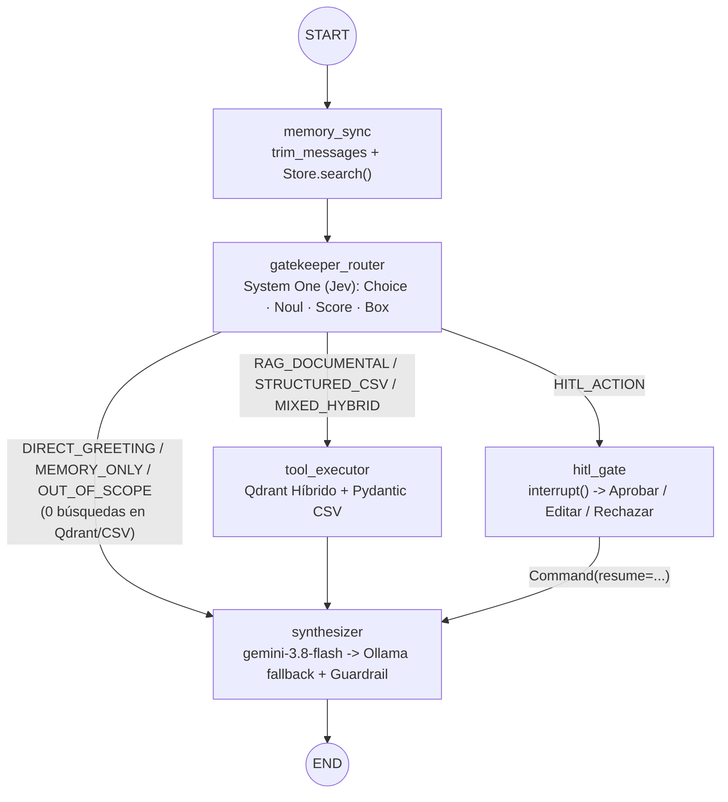
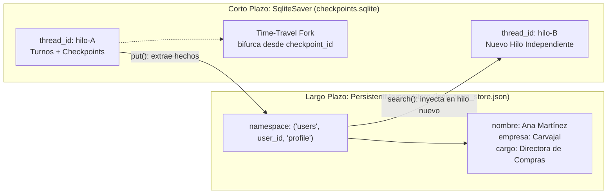
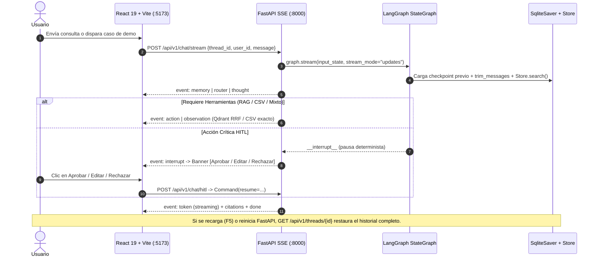

# Arquitectura Técnica y Evaluación — Módulo 2 (Agente Tecnoquímicas S.A.)

## 1. Diagrama del Grafo Agéntico (`StateGraph` + ReAct + HITL)

---

## 2. Checkpointer de Corto Plazo vs. Store de Largo Plazo

---

## 3. Flujo Completo Anti-Chat Ingenuo (SSE Multi-Evento + HITL + F5)

---

## 4. Criterio de Diseño: RAG Chains vs. RAG Agents

| Dimensión | RAG Chain (Módulo 1 — LCEL) | RAG Agent (Módulo 2 — LangGraph) |
| :--- | :--- | :--- |
| **Flujo de control** | Estático y unidireccional (`prompt \| llm \| parser`). | Dinámico, condicional e iterativo (bucle ReAct + Router). |
| **Decisión de búsqueda** | Siempre inyecta todo el contexto o busca en cada turno. | Gatekeeper System One decide si buscar en Qdrant, consultar CSV o responder directo (ahorro de tokens y latencia). |
| **Datos estructurados** | Propenso a aritmética aproximada sobre texto plano. | Invoca herramientas `@tool` Pydantic deterministas en Python. |
| **Memoria e HITL** | Sin memoria durable ni pausas de aprobación humana. | `SqliteSaver` (`thread_id`), `Store` entre hilos, Time-Travel y `interrupt()`. |
| **Elección en TQ** | Ideal para resúmenes batch fijos (`SUMMARY_PROMPT`). | Obligatorio para el asistente corporativo multi-fuente auditable. |

---

## 5. Comparativa de Orquestadores y Paradigmas Alternativos

| Framework / Paradigma | Fortaleza Principal | Cuándo Elegirlo vs. LangGraph en Tecnoquímicas |
| :--- | :--- | :--- |
| **LangChain v1 + LangGraph** *(Elegido)* | Control explícito de estado (`StateGraph`), `SqliteSaver`, `Store` con namespaces, `interrupt()` HITL, Time-Travel y trazas nativas en LangSmith. | **Óptimo para TQ:** exige auditabilidad farmacéutica, pausa HITL, memoria dual y desacoplamiento SSE limpio. |
| **LlamaIndex Workflows** | Excelente en ingesta documental heterogénea, pipelines de indexación complejos y Query Engines declarativos. | Útil si la prioridad fuese únicamente ETL de miles de PDFs clínicos heterogéneos sin ciclos HITL complejos. |
| **Agno (ex-Phidata)** | Arranque veloz de agentes con memoria integrada y menor código boilerplate. | Adecuado para prototipos rápidos, pero ofrece menor control granular de checkpoints y grafos cíclicos que LangGraph. |
| **DSPy** | Compilación y optimización automática de prompts y pesos de recuperación mediante métricas programáticas. | Complementario para optimizar prompts del sintetizador cuando existe un dataset masivo de pares gold. |
| **smolagents (Code Agents)** | El modelo escribe y ejecuta bloques Python como acción en lugar de JSON tool calling. | Potente para análisis exploratorio abierto; riesgoso en entorno farmacéutico regulado frente a `@tool` Pydantic acotadas. |
| **LLM Wiki / OKF (Open Knowledge Framework)** | Mantiene una base de conocimiento viva curada y enlazada por el propio LLM (páginas Markdown interconectadas con linaje). | Paradigma alternativo valioso a futuro para consolidar SOPs internos de TQ en una wiki versionada antes de vectorizar. |

---

## 6. Diseño y Resultados de Evaluación del Retrieval (`Recall@10` y `nDCG@10`)

Se evaluó el motor sobre **25 consultas etiquetadas** ([`data/evaluation/m2_retrieval_dataset.json`](../data/evaluation/m2_retrieval_dataset.json)) cubriendo los 7 documentos oficiales del corpus Gold de Tecnoquímicas (`tqconfiable.com` y `tqfarma.com`), comparando 3 estrategias en Qdrant (índice ANN `HNSW m=16, ef_construct=100`):

| Estrategia en Qdrant | Consultas | Recall@5 | Recall@10 | MRR | nDCG@10 |
| :--- | :---: | :---: | :---: | :---: | :---: |
| **Dense Only** (`Cosine 128d`) | 25 | 0.96 | 0.96 | 0.8133 | 0.7929 |
| **Lexical Only** (`Sparse BM25`) | 25 | 0.92 | 0.96 | 0.8744 | 0.8481 |
| **Hybrid RRF (Densa + Léxica)** | **25** | **0.96** | **1.00** | **0.8800** | **0.8475** |

- **Precisión del Router Gatekeeper (Jev):** **100%** (11/11 casos: saludos sin quemar Qdrant, memoria `Store`, CSV exacto, RAG, enrutamiento mixto, HITL y rechazo `Out-of-Scope`).
- **Tasa de bloqueo de Prompt Injection Indirecto:** **100%** gracias al detector léxico-estructural + encapsulación en `<contexto_documental_pasivo>`.

---

## 7. Arquitectura de Decisiones (ADRs)

Cada decisión de diseño está documentada de forma independiente en [`docs/adr/`](adr/README.md) (`ADR-0001` a `ADR-0007`), cubriendo LangGraph, Qdrant RRF, Memoria Dual, Gatekeeper Jev, Blindaje RAG, Gemini/Ollama Fallback y Frontend 3D SSE + Apagado limpio.
